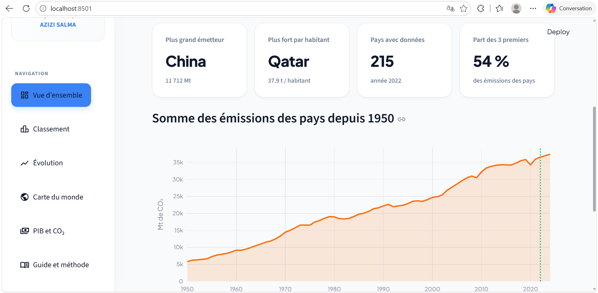
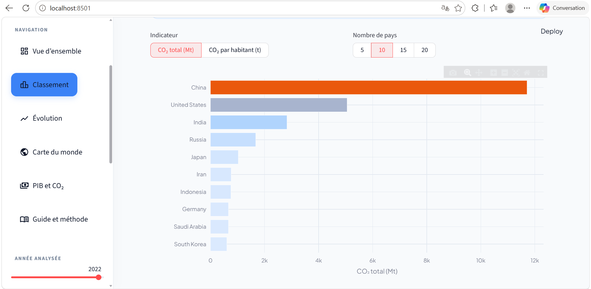
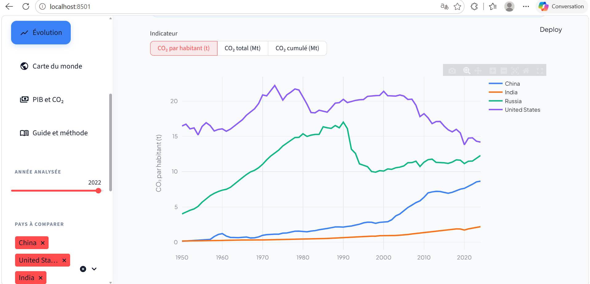
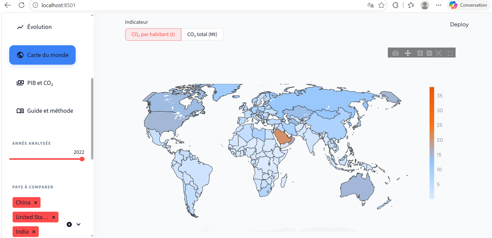
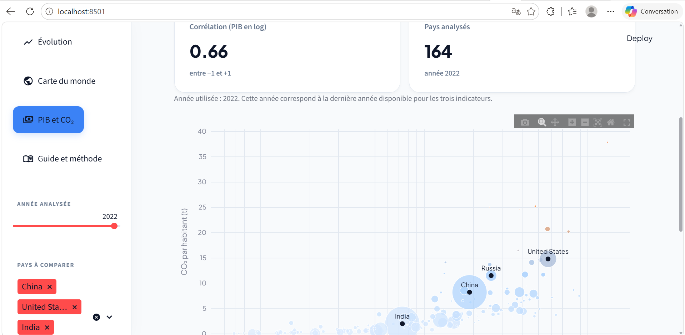
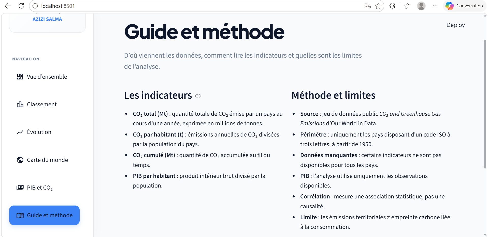

# CO₂ Analyst – Global Carbon Emissions Dashboard

An interactive data analysis dashboard built with Python, Pandas, NumPy, Plotly, and Streamlit to explore global CO₂ emissions trends and compare countries.

## Project Overview

CO₂ Analyst is a data analysis project based on the Our World in Data (OWID) CO₂ dataset.

The dashboard allows users to explore annual CO₂ emissions, compare countries, analyze historical trends, and investigate the relationship between GDP per capita and CO₂ emissions.

## Features

- **Overview:** Key indicators and global emissions trends.
- **Country Ranking:** Compare countries by annual CO₂ emissions.
- **Historical Evolution:** Explore emissions over time.
- **World Map:** Visualize emissions geographically.
- **GDP & CO₂ Analysis:** Explore the relationship between GDP per capita and CO₂ emissions.
- **Interactive Filters:** Select years and countries.
- **Data Export:** Download filtered data as CSV.

## Technologies Used

- Python
- Pandas
- NumPy
- Plotly
- Streamlit

## Dataset

Source: [Our World in Data – CO₂ and Greenhouse Gas Emissions](https://github.com/owid/co2-data)

The analysis focuses on country-level records with valid three-letter ISO codes from 1950 onwards.

## Project Structure

```text
CO2-Analyst/
│
├── app.py
├── analysis.py
├── comparison.py
├── explore.py
├── gdp_analysis.py
├── requirements.txt
├── .gitignore
└── README.md
```

## Installation and Execution

### 1. Clone the repository

```bash
git clone https://github.com/Azizi-Salma/CO2-Analyst.git
cd CO2-Analyst
```

### 2. Install dependencies

```bash
pip install -r requirements.txt
```

### 3. Run the dashboard

```bash
streamlit run app.py
```

The application will open in your browser.

## Data Notes

- Missing values are handled according to the needs of each analysis.
- GDP data availability varies by year.
- Correlation does not imply causation.
- CO₂ indicators represent different aspects of emissions and should not be interpreted interchangeably.

## Dashboard Screenshots

### Overview


### Country Ranking


### Historical Evolution


### World Map


### GDP and CO2 Analysis


### Guide and Methodology


## Author

**Salma Azizi**

Data Analysis Project – 2026